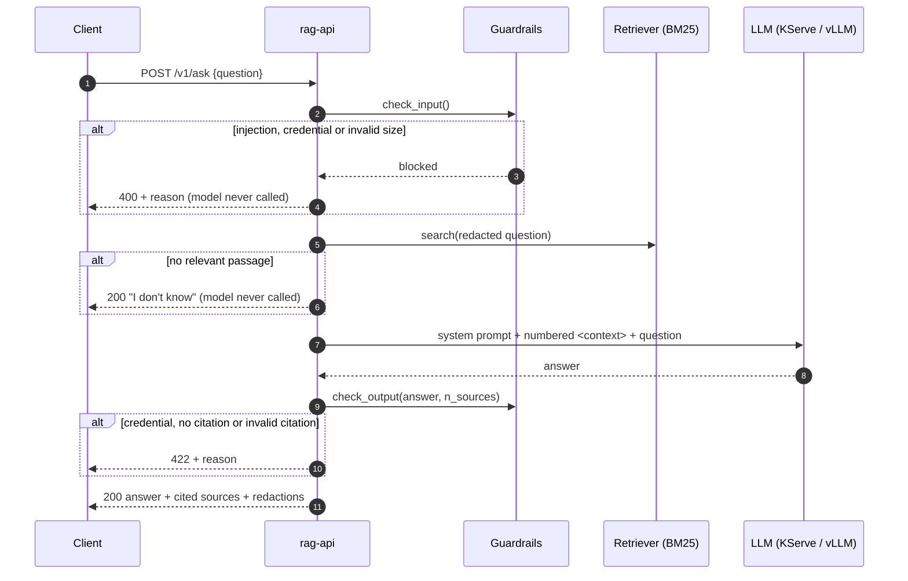
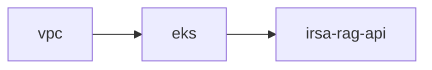

# Architecture

## Request flow

## Infrastructure dependency graph

Terragrunt stacks under `infra/live/dev` are applied in this order:

| Stack | Creates |
| --- | --- |
| `vpc` | VPC across 2-3 AZs, private + public subnets, NAT, flow logs, locked default SG |
| `eks` | EKS cluster, KMS key for Secrets, add-ons (VPC CNI with network policy, CoreDNS, kube-proxy, Pod Identity agent), `system` node group and a GPU `inference` node group (spot, scales from 0) |
| `irsa-rag-api` | IAM role assumable only by `system:serviceaccount:rag:rag-api`, read-only on one S3 prefix |

## Policy enforcement points

The same rules are enforced twice, on purpose:

1. **In CI (shift-left)**: `conftest` runs `policies/kubernetes` against the manifests; Checkov and Trivy scan Terraform, Kubernetes and the Dockerfile. A bad change fails the pull request.
2. **At admission (runtime)**: Pod Security Admission (`restricted`) and Gatekeeper constraints reject anything that bypassed CI, such as a manual `kubectl apply`.

## Design decisions

See [docs/adr](adr/).
